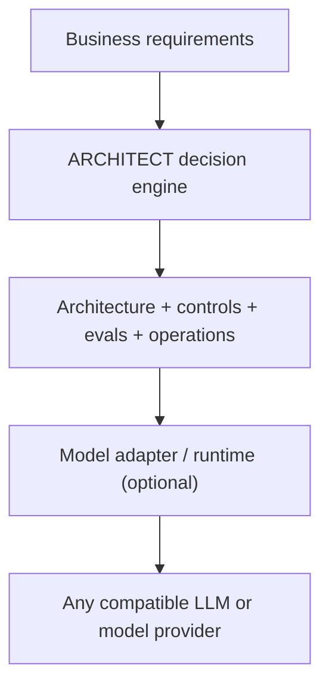
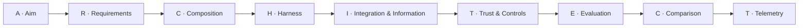

# 🏛️ ARCHITECT — Vendor-Neutral AI Architecture Decision Framework

🇧🇷 [Leia em português](README.pt-br.md)

[](https://github.com/brunovicco/architect-ai-framework/actions/workflows/ci.yml)
[](LICENSE)
[](pyproject.toml)

ARCHITECT (the English rendition of the original **ARQUITETO** method) is a **provider-agnostic** decision framework and web app for designing AI/LLM systems, from business problem to production operating plan. It was built while studying for the **Claude Architect Professional** certification, as a way to put the certification's architecture-decision concepts — responsibility boundaries, workflow vs. agent, trust & controls, evaluation — into a repeatable, working tool instead of leaving them as notes.

It can be used with **any model family, hosting model or provider**. The core decision engine has no dependency on any specific model provider, cloud platform or runtime.

The project turns architecture reasoning into a repeatable, 9-step workflow, spelled out as the word **ARCHITECT**:

**A**im → **R**equirements → **C**omposition → **H**arness → **I**ntegration & Information → **T**rust & Controls → **E**valuation → **C**omparison → **T**elemetry.

## Live demo

**[architect-ai-framework.streamlit.app](https://architect-ai-framework.streamlit.app)** — hosted on Streamlit Community Cloud, no install needed.

## Screenshots

<table>
<tr>
<td><br><sub>1 · A/R — Aim &amp; Requirements</sub></td>
<td><br><sub>3 · I — Integration &amp; Information</sub></td>
</tr>
<tr>
<td><br><sub>5 · Comparison — weighted trade-offs</sub></td>
<td><br><sub>6 · Plan — the generated decision plan</sub></td>
</tr>
</table>

The UI is fully bilingual (pt-BR / en) and ships with a one-click example case ("Investment Assistant") so you can see a populated plan immediately.

## What the app does

- Guides discovery of business outcomes, SLAs and hard constraints.
- Recommends a starting architecture: Augmented LLM, Workflow, Agent or Multi-agent.
- Separates responsibilities between probabilistic models, deterministic software and humans.
- Helps decide between RAG, APIs/tools, protocol-based tool discovery and agent-to-agent integration.
- Generates security/governance recommendations such as least privilege, execution-layer authorization, HITL and fail-closed behavior.
- Produces an evaluation and observability plan.
- Compares up to three architecture options with weighted trade-offs.
- Exports the final **Architecture Decision Plan** as Markdown, DOCX or JSON — in either language.

## Vendor-neutral by design

ARCHITECT treats the model as an interchangeable architecture component.



The deterministic core does **not** call an LLM. A future AI reviewer can be connected through a provider adapter (see `src/arquiteto/providers.py`) without changing the decision engine.

The framework therefore works equally well with:

- managed model APIs;
- cloud-hosted foundation models;
- self-hosted/open-weight models;
- model gateways/routers;
- hybrid or multi-model architectures.

Provider selection is a **trade-off decision**, not a framework dependency.

## The 9-step method



## Why this exists

AI architecture discussions often jump too early to model brands, agents, RAG or tool protocols. ARCHITECT starts with the business problem and hard constraints, then separates responsibilities between probabilistic model behavior, deterministic software and humans.

> Prefer the simplest architecture that satisfies hard requirements and keep critical enforcement outside probabilistic model behavior whenever possible.

## Quick start

```bash
python -m venv .venv
source .venv/bin/activate  # Windows: .venv\\Scripts\\activate
pip install -e .
streamlit run app.py
```

Open the local Streamlit URL and walk through the six tabs (or click **Load example: Investment Assistant** in the sidebar). The final tab provides downloadable Markdown, DOCX and JSON artifacts, translated into whichever language is selected.

## Run tests / lint / type-check

```bash
pip install -e '.[dev]'
pytest
ruff check .
mypy src
pip-audit
```

All four run in CI on every push (Python 3.11 and 3.12), together with Dependabot (weekly updates for pip and GitHub Actions) and pinned, SHA-locked Actions — see [Repository structure](#repository-structure) and `.github/`.

## Deploy

Live at **[architect-ai-framework.streamlit.app](https://architect-ai-framework.streamlit.app)**, hosted on [Streamlit Community Cloud](https://streamlit.io/cloud) (free tier). To deploy your own fork:

1. Push the repo to your own GitHub account (or fork it).
2. Go to [share.streamlit.io](https://share.streamlit.io) and sign in with GitHub.
3. Click **New app**, pick your repository and branch (`main`), and set the main file path to `app.py`.
4. Deploy. Streamlit Cloud installs from `requirements.txt` and reads the Python version from `runtime.txt` automatically — no extra configuration needed.

## Repository structure

```text
architect-ai-framework/
├── app.py
├── src/arquiteto/
│   ├── engine.py       # deterministic recommendation engine
│   ├── exporters.py    # bilingual Markdown and DOCX generation
│   ├── i18n.py          # UI strings, ARQUITETO/ARCHITECT step words, translations
│   ├── models.py       # domain models
│   ├── providers.py    # optional model-adapter contract (unused by the engine)
│   └── scoring.py      # weighted trade-off matrix
├── docs/
│   ├── FRAMEWORK.md
│   ├── PROVIDER_NEUTRALITY.md
│   └── screenshots/     # README screenshots, pt-br/ and en/
├── examples/
│   └── investment_assistant.json
├── assets/
│   └── Framework_ARQUITETO_AI.xlsx
├── .github/workflows/ci.yml
└── tests/
```

## Design principles

1. **Provider-neutral core.** No provider SDK or vendor-specific API is required by the decision engine.
2. **Deterministic core first.** The app does not require an LLM to make its primary recommendations.
3. **Hard constraints beat weighted scores.** A high aggregate score cannot rescue an option that violates a non-negotiable requirement.
4. **Controls belong at the right layer.** Prompts guide behavior; authorization and critical side-effect policy belong at execution boundaries.
5. **Agentic complexity must earn its place.** Workflow is preferred when the path is known; agents are used when the system genuinely must discover the path.
6. **Evaluation is part of architecture.** Quality, latency, cost, safety/security and cohort behavior are planned before production promotion.
7. **Model choice follows requirements.** Capability, latency, cost, context, privacy, residency and operational constraints determine the model/runtime choice.

## Roadmap

- [x] Bilingual UI and exports (pt-BR / en)
- [x] Interactive architecture diagram (Mermaid)
- [x] Public deployment (Streamlit Community Cloud)
- [x] CI/supply-chain hardening (Dependabot, pip-audit, pinned Actions, branch protection)
- [ ] Import/export existing JSON plans
- [ ] PDF export
- [ ] Optional vendor-neutral LLM reviewer via adapter interface
- [ ] Model/provider comparison matrix
- [ ] Saved case library
- [ ] Architecture Decision Record (ADR) export

## Contributing

See [CONTRIBUTING.md](CONTRIBUTING.md).

## License

MIT
