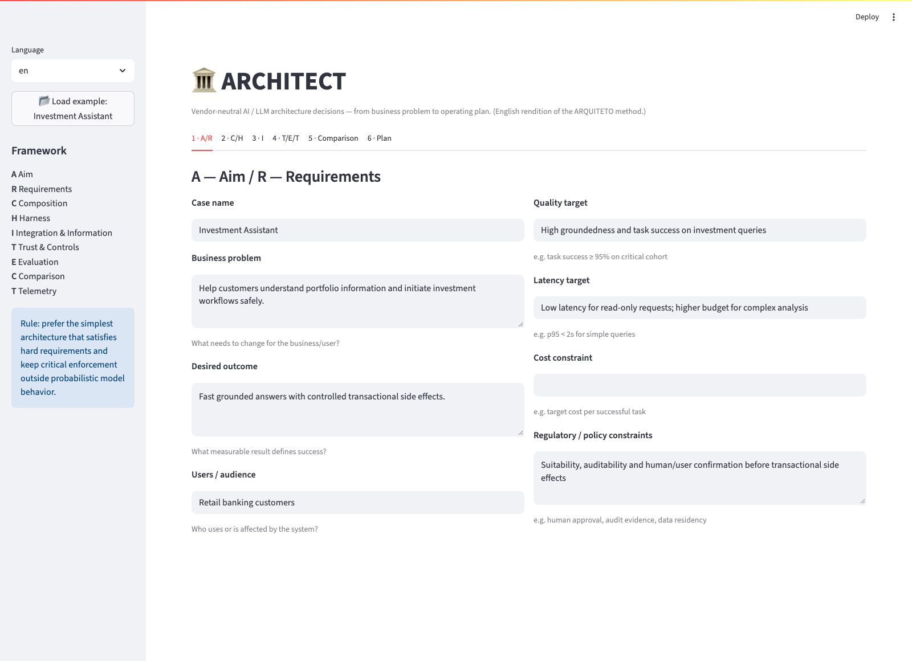
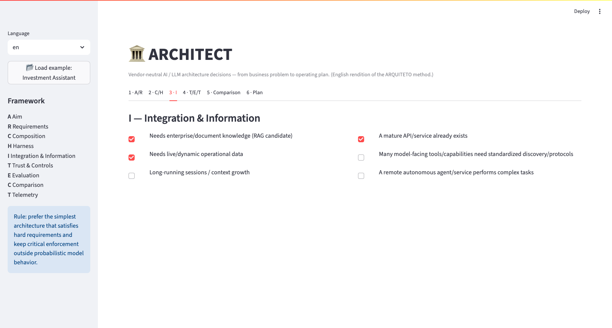
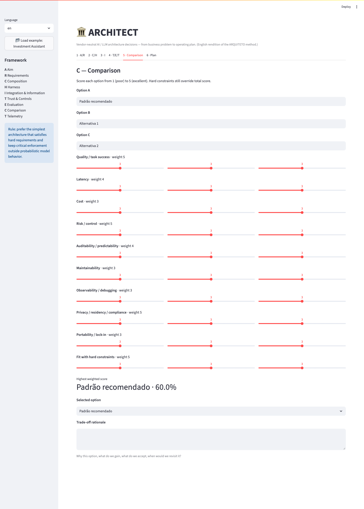
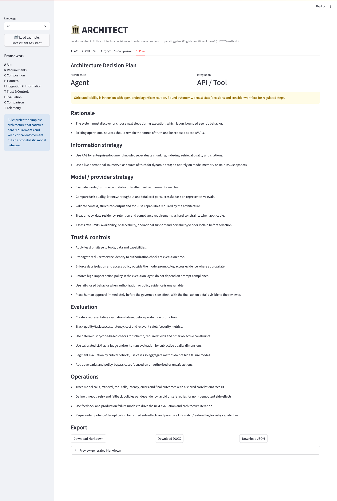
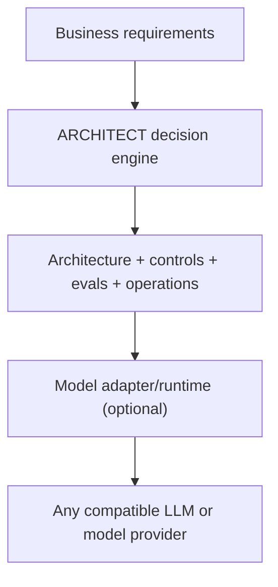
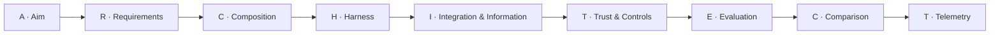

# ARCHITECT - Vendor-Neutral AI Architecture Decision Framework

[Leia em português](README.pt-br.md)

[](https://github.com/brunovicco/architect-ai-framework/actions/workflows/ci.yml)
[](LICENSE)
[](pyproject.toml)

ARCHITECT is a **provider-agnostic** decision framework and web app for designing AI/LLM systems, from business problem to production operating plan. It turns professional AI-architecture practice - responsibility boundaries, workflow vs. agent, trust & controls, evaluation - into a repeatable, guided tool: answer a structured set of questions about your use case and get a complete, exportable Architecture Decision Plan back.

It can be used with **any model family, hosting model or provider**. The core decision engine has no dependency on any specific model provider, cloud platform or runtime.

The project turns architecture reasoning into a repeatable, 9-step workflow, spelled out as the word **ARCHITECT**:

**A**im → **R**equirements → **C**omposition → **H**arness → **I**ntegration & Information → **T**rust & Controls → **E**valuation → **C**omparison → **T**elemetry.

## Live demo

**[architect-ai-framework.streamlit.app](https://architect-ai-framework.streamlit.app)** - hosted on Streamlit Community Cloud, no install needed.

## Screenshots

<table>
<tr>
<td><br><sub>1 · A/R - Aim &amp; Requirements</sub></td>
<td><br><sub>3 · I - Integration &amp; Information</sub></td>
</tr>
<tr>
<td><br><sub>5 · Comparison - weighted trade-offs</sub></td>
<td><br><sub>7 · Plan - the generated decision plan</sub></td>
</tr>
</table>

The UI ships with a one-click example case ("Investment Assistant") so you can see a populated plan immediately.

## What the app does

- Guides discovery of business outcomes, SLAs and hard constraints.
- Recommends a starting architecture: Augmented LLM, Workflow, Agent or Multi-agent - plus a named reference architecture (RAG pipeline, routing, coding agent, orchestrator-workers, ...) and a vendor-neutral entry-point category (hosted chat/web UI, agentic coding assistant, direct API/SDK, protocol server for multi-client reuse).
- Separates responsibilities between probabilistic models, deterministic software and humans, justified through reversibility/stakes/accountability and named against the four model properties (next-token prediction, knowledge, working memory, steerability).
- Helps decide between RAG, APIs/tools, protocol-based tool discovery and agent-to-agent integration.
- Generates security/governance recommendations such as least privilege, execution-layer authorization, HITL and fail-closed behavior, input/output screening, fairness-injection-point auditing, and a stakes-driven review placement (pre-action approval/sampled review/post-action audit).
- Produces an evaluation and observability plan, including structured A/B-experiment guidance and a feasibility verdict against an optional cost ceiling.
- Compares up to three architecture options with weighted trade-offs.
- Compares model/provider candidates across 8 vendor-neutral criteria (quality fit, latency, cost, context window, structured output, privacy/residency, rate limits, portability) - structure only, no opinion on which vendor to pick.
- Exports the final **Architecture Decision Plan** as Markdown, DOCX, PDF, JSON or a Nygard-style **ADR** - in either language.
- Round-trips a plan: re-import a previously exported JSON file, or save/load named drafts for the current browser session.
- Optional, vendor-neutral **AI review**: point it at any OpenAI-chat-completions-compatible endpoint (OpenAI, Ollama, vLLM, a gateway...) to get a critique of the generated plan. Guarded against SSRF - see [Security](#security).

## Vendor-neutral by design

ARCHITECT treats the model as an interchangeable architecture component.



The deterministic core does **not** call an LLM. A future AI reviewer can be connected through a provider adapter (see `src/architect/providers.py`) without changing the decision engine.

The framework therefore works equally well with:

- managed model APIs;
- cloud-hosted foundation models;
- self-hosted/open-weight models;
- model gateways/routers;
- hybrid or multi-model architectures.

Provider selection is a **trade-off decision**, not a framework dependency.

## The 9-step method



## Why this exists

AI architecture discussions often jump too early to model brands, agents, RAG or tool protocols. ARCHITECT starts with the business problem and hard constraints, then separates responsibilities between probabilistic model behavior, deterministic software and humans.

> Prefer the simplest architecture that satisfies hard requirements and keep critical enforcement outside probabilistic model behavior whenever possible.

## Quick start

```bash
python -m venv .venv
source .venv/bin/activate  # Windows: .venv\\Scripts\\activate
pip install -e .
streamlit run app.py
```

Open the local Streamlit URL and walk through the seven tabs (or click **Load example: Investment Assistant** in the sidebar). The Plan tab provides downloadable Markdown, DOCX, PDF, ADR and JSON artifacts, translated into whichever language is selected - plus a session-only saved-case library and an optional AI review.

## Using the AI review

The Plan tab includes an optional, vendor-neutral **AI Review** panel that sends the generated plan to any OpenAI-chat-completions-compatible endpoint and returns a critique inside the app.

1. Open the **Plan** tab and expand **AI Review (optional)**.
2. Fill in:
   - **Base URL** - the endpoint's base URL, e.g. `https://api.openai.com/v1` for OpenAI, or the public HTTPS URL of any OpenAI-compatible gateway (Ollama, vLLM, LM Studio, a self-hosted proxy...).
   - **API key** - your key for that endpoint.
   - **Model name** - the model identifier the endpoint expects, e.g. `gpt-4o-mini`.
3. Click **Get AI review**.

A few things worth knowing:

- The endpoint must be reachable over **public HTTPS** - `localhost` and private/internal addresses are rejected outright by the built-in SSRF guard, so a purely local Ollama/vLLM instance needs to sit behind a public hostname (a tunnel or reverse proxy) to be usable here.
- It's entirely optional: the deterministic plan - architecture, controls, evaluation, operations - is already complete without it. The AI review only adds a second opinion on top.
- The API key stays in memory for that one request only; it's never logged or persisted, and nothing is sent anywhere until all three fields are filled in and the button is clicked. See [Security](#security) for the full guarantee.

## Run tests/lint/type-check

```bash
pip install -e '.[dev]'
pytest
ruff check .
mypy src
pip-audit
```

All four run in CI on every push (Python 3.11 and 3.12), together with Dependabot (weekly updates for pip and GitHub Actions) and pinned, SHA-locked Actions - see [Repository structure](#repository-structure) and `.github/`.

## Deploy

Live at **[architect-ai-framework.streamlit.app](https://architect-ai-framework.streamlit.app)**, hosted on [Streamlit Community Cloud](https://streamlit.io/cloud) (free tier). To deploy your own fork:

1. Push the repo to your own GitHub account (or fork it).
2. Go to [share.streamlit.io](https://share.streamlit.io) and sign in with GitHub.
3. Click **New app**, pick your repository and branch (`main`), and set the main file path to `app.py`.
4. Deploy. Streamlit Cloud installs from `requirements.txt` and reads the Python version from `runtime.txt` automatically - no extra configuration needed.

## Security

The deterministic core never calls a model or makes a network request. The
only network-calling, credential-handling code path is the optional AI
review (`OpenAICompatibleAdapter`), which validates its target URL against
an SSRF guard (rejects non-`https`, localhost, private/loopback/link-local
addresses, including the cloud metadata IP) before ever connecting - API
keys stay in-memory for one request and are never logged or persisted.

See [SECURITY.md](SECURITY.md) for the full threat model and how to report
a vulnerability, and
[docs/PROVIDERS_SECURITY_CHECKLIST.md](docs/PROVIDERS_SECURITY_CHECKLIST.md)
for the OWASP LLM Top 10/MITRE ATLAS-mapped checklist any new adapter must
satisfy.

## Repository structure

```text
architect-ai-framework/
├── app.py
├── src/architect/
│   ├── engine.py       # deterministic recommendation engine
│   ├── exporters.py    # bilingual Markdown, DOCX, PDF and ADR generation
│   ├── i18n.py          # UI strings, ARQUITETO/ARCHITECT step words, translations
│   ├── models.py       # domain models
│   ├── providers.py    # optional model-adapter contract + SSRF-guarded adapter
│   └── scoring.py      # weighted trade-off matrix
├── docs/
│   ├── FRAMEWORK.md
│   ├── PROVIDER_NEUTRALITY.md
│   ├── PROVIDERS_SECURITY_CHECKLIST.md
│   └── screenshots/     # README screenshots, pt-br/ and en/
├── examples/
│   └── investment_assistant.json
├── assets/
│   └── Framework_ARQUITETO_AI.xlsx
├── .github/
│   ├── workflows/ci.yml
│   └── dependabot.yml
├── SECURITY.md
└── tests/
```

## Design principles

1. **Provider-neutral core.** No provider SDK or vendor-specific API is required by the decision engine.
2. **Deterministic core first.** The app does not require an LLM to make its primary recommendations.
3. **Hard constraints beat weighted scores.** A high aggregate score cannot rescue an option that violates a non-negotiable requirement.
4. **Controls belong at the right layer.** Prompts guide behavior; authorization and critical side-effect policy belong at execution boundaries.
5. **Agentic complexity must earn its place.** Workflow is preferred when the path is known; agents are used when the system genuinely must discover the path.
6. **Evaluation is part of architecture.** Quality, latency, cost, safety/security and cohort behavior are planned before production promotion.
7. **Model choice follows requirements.** Capability, latency, cost, context, privacy, residency and operational constraints determine the model/runtime choice.

## Contributing

See [CONTRIBUTING.md](CONTRIBUTING.md).

## License

MIT
