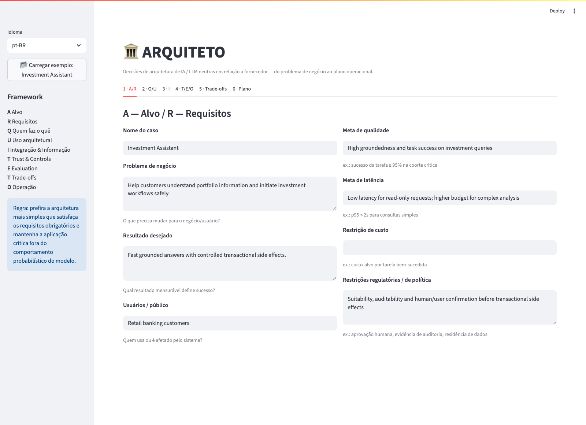
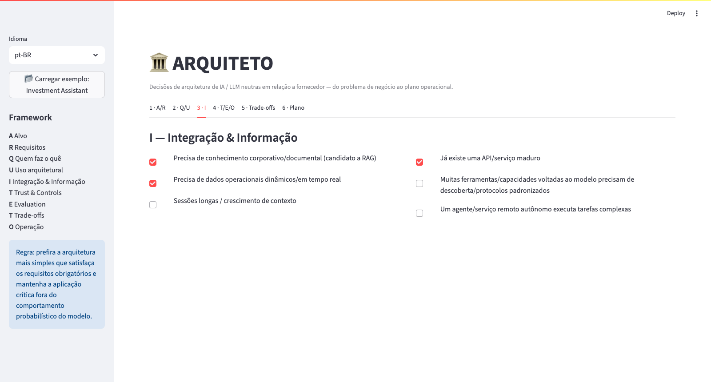
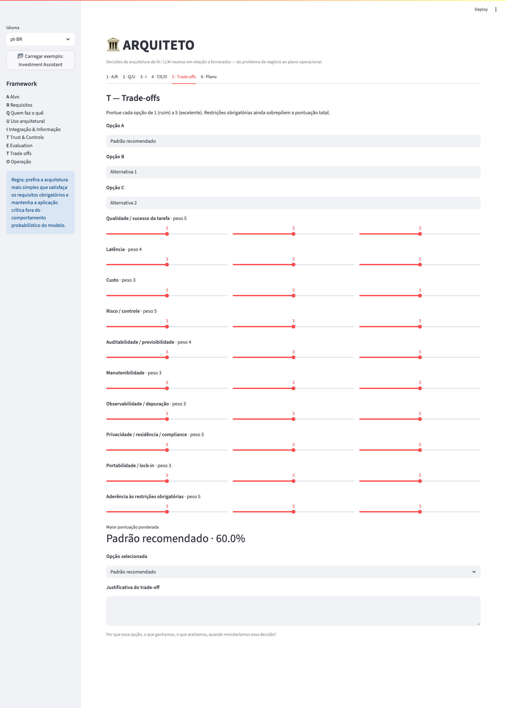
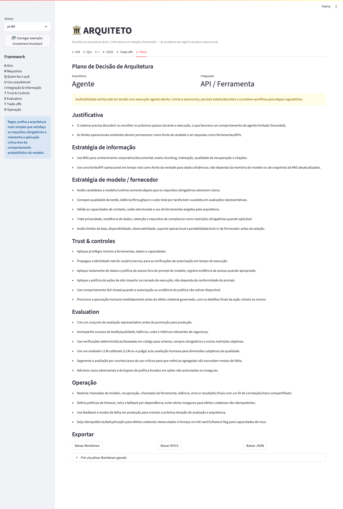
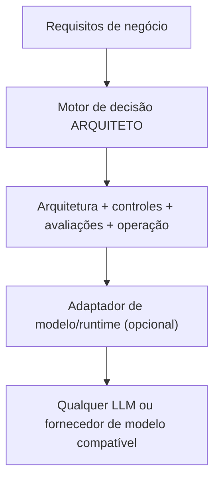
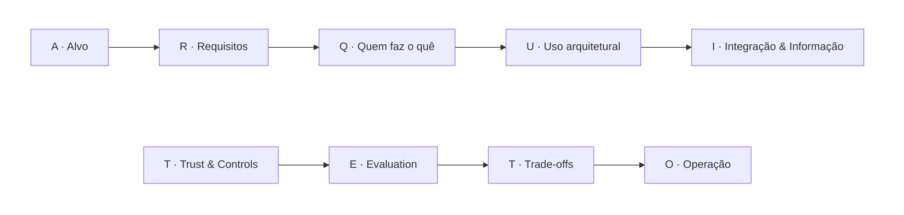

# ARQUITETO - Framework de Decisão de Arquitetura de IA Neutro em Fornecedor

[Read in English](README.md)

[](https://github.com/brunovicco/architect-ai-framework/actions/workflows/ci.yml)
[](LICENSE)
[](pyproject.toml)

ARQUITETO é um **framework de decisão de arquitetura de IA neutro em relação a fornecedor**, para engenheiros, arquitetos e lideranças técnicas. Comece pelo problema de negócio e pelas restrições, avalie se software determinístico basta e então considere LLM aumentado, workflow, agente ou multiagente.

O resultado é um **Architecture Decision Plan**: arquitetura proposta, justificativa, controles, orientação de avaliação, considerações operacionais e trade-offs explícitos, exportável em Markdown, DOCX, PDF, JSON ou ADR.

**[Experimente a demo pública](https://architect-ai-framework.streamlit.app)** · [Leia o método](docs/FRAMEWORK.md) · [Conteste uma recomendação](https://github.com/brunovicco/architect-ai-framework/issues/new?template=recommendation-feedback.yml)

O core aplica regras Python inspecionáveis a entradas estruturadas; não pede a um LLM que escolha a arquitetura. As mesmas entradas e versão de regras produzem a mesma recomendação. Streamlit é a implementação interativa. A crítica opcional por IA fica separada do motor de decisão.

## Experimente em dois minutos

1. Abra a demo e clique em **Carregar exemplo: Investment Assistant** na barra lateral. Se estiver hibernando, aguarde a inicialização.
2. Confira os sinais de execução na aba 2 e abra **7 · Plano**. A escolha dinâmica de ferramentas explica a recomendação de Agente; a aprovação de transações continua na camada de execução.
3. Compare alternativas e exporte o plano. Use dados fictícios ou sanitizados na demo pública.

**Escopo:** a alternativa de software determinístico registra sua avaliação explícita de que regras/APIs bastam; isso não é inferido do texto. Restrições em texto livre, elegibilidade das opções e afirmações sobre fornecedores exigem validação humana. Os controles gerados orientam o desenho; não são enforcement implantado nem certificação de compliance.

## Demo ao vivo

**[architect-ai-framework.streamlit.app](https://architect-ai-framework.streamlit.app)** - hospedado no Streamlit Community Cloud, sem precisar instalar nada.

## Screenshots

<table>
<tr>
<td><br><sub>1 · A/R - Alvo e Requisitos</sub></td>
<td><br><sub>3 · I - Integração &amp; Informação</sub></td>
</tr>
<tr>
<td><br><sub>5 · Trade-offs - comparação ponderada</sub></td>
<td><br><sub>7 · Plano - o plano de decisão gerado</sub></td>
</tr>
</table>

A interface vem com um caso de exemplo de um clique ("Investment Assistant") para você ver um plano preenchido imediatamente.

## O que o framework produz

- Guia a descoberta de resultados de negócio, SLAs e restrições obrigatórias.
- Recomenda uma arquitetura inicial: Software determinístico, LLM Aumentado, Workflow, Agente ou Multiagente - além de uma reference architecture nomeada (pipeline de RAG, roteamento, agente de código, orquestrador-trabalhadores, ...) e uma categoria de ponto de entrada neutra em fornecedor (chat/UI web hospedado, assistente de código agêntico, API/SDK direto, servidor de protocolo para reaproveitamento multi-cliente).
- Separa responsabilidades entre modelos probabilísticos, software determinístico e humanos, justificadas por reversibilidade/stakes/accountability e nomeadas conforme as quatro propriedades do modelo (previsão do próximo token, conhecimento, memória de trabalho, steerability).
- Ajuda a decidir entre RAG, APIs/ferramentas, descoberta de ferramentas via protocolo e integração agente-a-agente.
- Gera recomendações de segurança/governança como privilégio mínimo, autorização na camada de execução, HITL e comportamento fail-closed, input/output screening, auditoria dos pontos de injeção de viés, e um posicionamento de revisão orientado por stakes (aprovação prévia/revisão por amostragem/auditoria posterior).
- Produz um plano de avaliação e observabilidade, incluindo orientação de experimento A/B estruturado e um veredito de viabilidade contra um teto de custo opcional.
- Compara até três opções de arquitetura com trade-offs ponderados.
- Compara candidatos de modelo/fornecedor em 9 critérios neutros em fornecedor (aderência de qualidade, latência, custo, janela de contexto, saída estruturada, privacidade/residência, limites de taxa, portabilidade, explicabilidade/auditabilidade de viés) - só estrutura, sem opinião sobre qual fornecedor escolher.
- Exporta o **Plano de Decisão de Arquitetura** final em Markdown, DOCX, PDF, JSON ou um **ADR** no estilo Nygard - em qualquer um dos dois idiomas.
- Permite retomar um plano: reimporte um JSON exportado anteriormente, ou salve/carregue rascunhos nomeados durante a sessão atual do navegador.
- **Revisão por IA** opcional e neutra em fornecedor: use uma chave de demonstração compartilhada (com limite de uso) quando disponível, ou aponte para qualquer endpoint compatível com a API de chat da OpenAI (OpenAI, Ollama, vLLM, um gateway...) com sua própria chave, para obter uma crítica do plano gerado. Protegida contra SSRF - veja [Segurança](#segurança).

## Neutro em fornecedor por design

O ARQUITETO trata o modelo como um componente de arquitetura intercambiável.



O núcleo determinístico **não** chama nenhum LLM. O revisor opcional de IA está conectado através de um adaptador de fornecedor (veja `src/architect/providers.py`) sem alterar o motor de decisão.

O framework funciona igualmente bem com:

- APIs de modelo gerenciadas;
- modelos de fundação hospedados em nuvem;
- modelos self-hosted/open-weight;
- gateways/roteadores de modelo;
- arquiteturas híbridas ou multi-modelo.

A escolha do fornecedor é uma **decisão de trade-off**, não uma dependência do framework.

## O método em 9 passos



## Por que isso existe

Discussões de arquitetura de IA costumam pular cedo demais para marcas de modelo, agentes, RAG ou protocolos de ferramentas. O ARQUITETO começa pelo problema de negócio e pelas restrições obrigatórias, e só depois separa responsabilidades entre comportamento probabilístico do modelo, software determinístico e humanos.

> Prefira a arquitetura mais simples que satisfaça os requisitos obrigatórios e mantenha a aplicação crítica fora do comportamento probabilístico do modelo sempre que possível.

## Começando rápido

```bash
python -m venv .venv
source .venv/bin/activate  # Windows: .venv\\Scripts\\activate
pip install -e .
streamlit run app.py
```

Abra a URL local do Streamlit e percorra as sete abas (ou clique em **Carregar exemplo: Investment Assistant** no menu lateral). A aba Plano oferece Markdown, DOCX, PDF, ADR e JSON para download, traduzidos para o idioma selecionado - além de uma biblioteca de casos salvos (só na sessão) e uma revisão por IA opcional.

## Usando a revisão por IA

A aba Plano tem um painel opcional e neutro em fornecedor, **Revisão por IA**, que envia o plano gerado para um endpoint compatível com a API de chat da OpenAI e devolve uma crítica dentro do próprio app. Dois modos:

- **Chave de demonstração (compartilhada)** - aparece automaticamente quando o deploy tem uma credencial configurada (veja `docs/PROVIDERS_SECURITY_CHECKLIST.md`, controle #9). Não precisa colar nada: é só clicar em **Obter revisão por IA**. É limitada por um teto diário global e um teto por sessão de navegador, para manter o custo/abuso de uma credencial compartilhada entre visitantes anônimos sob controle.
- **Minha própria chave** - sempre disponível. Preencha:
  - **Base URL** - a URL base do endpoint, ex.: `https://api.openai.com/v1` para a OpenAI, ou a URL HTTPS pública de qualquer gateway compatível (Ollama, vLLM, LM Studio, um proxy self-hosted...).
  - **Chave de API** - sua chave para esse endpoint.
  - **Nome do modelo** - o identificador de modelo que o endpoint espera, ex.: `gpt-4o-mini`.

Em qualquer um dos dois modos, o passo final é clicar em **Obter revisão por IA**.

Alguns pontos importantes:

- O endpoint precisa estar acessível por **HTTPS público** - `localhost` e endereços privados/internos são rejeitados de cara pela guarda SSRF embutida, então uma instância local de Ollama/vLLM precisa ficar atrás de um hostname público (um túnel ou proxy reverso) para poder ser usada aqui.
- É totalmente opcional: o plano determinístico - arquitetura, controles, avaliação, operação - já sai completo sem isso. A revisão por IA só acrescenta uma segunda opinião por cima.
- No modo "minha própria chave", a chave de API fica na memória da sessão no servidor; nunca é logada nem persistida, e nada é enviado a lugar nenhum até os três campos serem preenchidos e o botão ser clicado. No modo compartilhado, a credencial vive só no secret store do deploy (nunca no repositório, nunca no navegador). Veja [Segurança](#segurança) para a garantia completa.

## Rodar testes/lint/type-check

```bash
pip install -e '.[dev]'
pytest
ruff check .
mypy src
pip-audit
```

Os quatro rodam no CI a cada push (Python 3.11 e 3.12), junto com o Dependabot (atualizações semanais de pip e GitHub Actions) e Actions fixadas por SHA - veja [Estrutura do repositório](#estrutura-do-repositório) e `.github/`.

## Deploy

No ar em **[architect-ai-framework.streamlit.app](https://architect-ai-framework.streamlit.app)**, hospedado no [Streamlit Community Cloud](https://streamlit.io/cloud) (camada gratuita). Para fazer deploy do seu próprio fork:

1. Faça push do repositório para sua própria conta do GitHub (ou faça um fork).
2. Acesse [share.streamlit.io](https://share.streamlit.io) e entre com GitHub.
3. Clique em **New app**, selecione seu repositório e a branch (`main`), e defina o caminho do arquivo principal como `app.py`.
4. Faça o deploy. O Streamlit Cloud instala a partir do `requirements.txt` e lê a versão do Python em `runtime.txt` automaticamente - não precisa de nenhuma configuração extra.

## Segurança

O núcleo determinístico nunca chama um modelo nem faz requisição de rede. O
único trecho de código que faz chamada de rede e lida com credencial é a
revisão por IA opcional (`OpenAICompatibleAdapter`), que valida a URL de
destino contra uma guarda SSRF (rejeita não-`https`, localhost, endereços
privados/loopback/link-local, incluindo o IP de metadados de nuvem) antes de
conectar. No modo "minha própria chave", a chave fica na memória da sessão no servidor e nunca é logada nem persistida; no modo de demonstração
compartilhada, a credencial vive só no secret store do deploy e as chamadas
são limitadas por tetos diário/por sessão e por tamanho de resposta, para
conter o raio de impacto de uma credencial compartilhada entre visitantes
anônimos.

Veja [SECURITY.md](SECURITY.md) (em inglês) para o modelo de ameaça completo
e como reportar uma vulnerabilidade, e
[docs/PROVIDERS_SECURITY_CHECKLIST.md](docs/PROVIDERS_SECURITY_CHECKLIST.md)
para o checklist mapeado ao OWASP LLM Top 10/MITRE ATLAS que qualquer novo
adaptador precisa satisfazer.

## Estrutura do repositório

```text
architect-ai-framework/
├── app.py
├── src/architect/
│   ├── engine.py       # motor de recomendação determinístico
│   ├── exporters.py    # geração bilíngue de Markdown, DOCX, PDF e ADR
│   ├── i18n.py          # textos da UI, palavras do método, traduções
│   ├── models.py       # modelos de domínio
│   ├── providers.py    # contrato de adaptador + adaptador protegido contra SSRF
│   └── scoring.py      # matriz de trade-off ponderada
├── docs/
│   ├── FRAMEWORK.md
│   ├── PROVIDER_NEUTRALITY.md
│   ├── PROVIDERS_SECURITY_CHECKLIST.md
│   └── screenshots/     # screenshots do README, pt-br/ e en/
├── examples/
│   └── investment_assistant.json
├── .github/
│   ├── workflows/ci.yml
│   └── dependabot.yml
├── SECURITY.md
└── tests/
```

## Princípios de design

1. **Núcleo neutro em fornecedor.** Nenhum SDK de fornecedor ou API específica de vendor é exigida pelo motor de decisão.
2. **Núcleo determinístico primeiro.** O app não depende de um LLM para suas recomendações principais.
3. **Restrições obrigatórias superam pontuações ponderadas.** Uma pontuação agregada alta não salva uma opção que viola um requisito não negociável.
4. **Controles pertencem à camada certa.** Prompts guiam comportamento; autorização e política de efeitos colaterais críticos pertencem às fronteiras de execução.
5. **Complexidade agêntica precisa se justificar.** Workflow é preferido quando o caminho é conhecido; agentes são usados quando o sistema genuinamente precisa descobrir o caminho.
6. **Avaliação é parte da arquitetura.** Qualidade, latência, custo, segurança e comportamento por coorte são planejados antes da promoção para produção.
7. **A escolha do modelo segue os requisitos.** Capacidade, latência, custo, contexto, privacidade, residência e restrições operacionais determinam a escolha de modelo/runtime.

## Contribuindo

Veja [CONTRIBUTING.md](CONTRIBUTING.md).

## Licença

MIT
