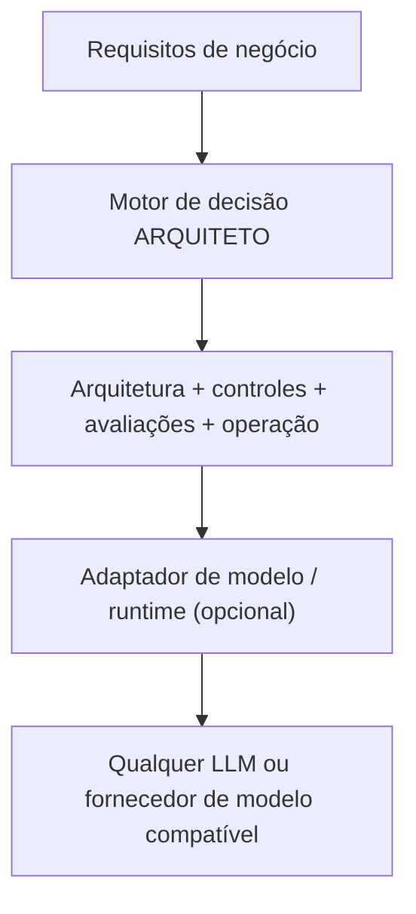
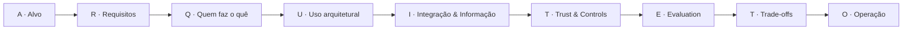

# 🏛️ ARQUITETO — Framework de Decisão de Arquitetura de IA Neutro em Fornecedor

🇺🇸 [Read in English](README.md)

[](https://github.com/brunovicco/architect-ai-framework/actions/workflows/ci.yml)
[](LICENSE)
[](pyproject.toml)

ARQUITETO (cuja tradução literal para o inglês, **ARCHITECT**, também é usada como marca na versão em inglês do app) é um framework de decisão e um web app **independentes de fornecedor** para desenhar sistemas de IA/LLM, do problema de negócio até o plano operacional de produção. O projeto nasceu durante a preparação para a certificação **Claude Architect Professional**, como forma de colocar em prática — numa ferramenta real e repetível, não só em anotações — os conceitos de decisão arquitetural da certificação: fronteiras de responsabilidade, workflow vs. agente, trust & controls, avaliação.

Pode ser usado com **qualquer família de modelo, modelo de hospedagem ou fornecedor**. O motor de decisão central não tem nenhuma dependência de um provedor de modelo, plataforma de nuvem ou runtime específico.

O projeto transforma o raciocínio de arquitetura em um workflow repetível de 9 passos, que soletra a palavra **ARQUITETO**:

**A**lvo → **R**equisitos → **Q**uem faz o quê → **U**so arquitetural → **I**ntegração & Informação → **T**rust & Controls → **E**valuation → **T**rade-offs → **O**peração.

## Demo ao vivo

<!-- TODO: substituir pela URL do Streamlit Community Cloud depois do deploy — veja "Deploy" abaixo -->
Ainda não implantado — veja [Deploy](#deploy) para a configuração única, ou rode localmente em [Começando rápido](#começando-rápido).

## Screenshots

<table>
<tr>
<td><br><sub>1 · A/R — Alvo e Requisitos</sub></td>
<td><br><sub>3 · I — Integração &amp; Informação</sub></td>
</tr>
<tr>
<td><br><sub>5 · Trade-offs — comparação ponderada</sub></td>
<td><br><sub>6 · Plano — o plano de decisão gerado</sub></td>
</tr>
</table>

A interface é totalmente bilíngue (pt-BR / en) e vem com um caso de exemplo de um clique ("Investment Assistant") para você ver um plano preenchido imediatamente.

## O que o app faz

- Guia a descoberta de resultados de negócio, SLAs e restrições obrigatórias.
- Recomenda uma arquitetura inicial: LLM Aumentado, Workflow, Agente ou Multiagente.
- Separa responsabilidades entre modelos probabilísticos, software determinístico e humanos.
- Ajuda a decidir entre RAG, APIs/ferramentas, descoberta de ferramentas via protocolo e integração agente-a-agente.
- Gera recomendações de segurança/governança como privilégio mínimo, autorização na camada de execução, HITL e comportamento fail-closed.
- Produz um plano de avaliação e observabilidade.
- Compara até três opções de arquitetura com trade-offs ponderados.
- Exporta o **Plano de Decisão de Arquitetura** final em Markdown, DOCX ou JSON — em qualquer um dos dois idiomas.

## Neutro em fornecedor por design

O ARQUITETO trata o modelo como um componente de arquitetura intercambiável.



O núcleo determinístico **não** chama nenhum LLM. Um futuro revisor de IA pode ser conectado através de um adaptador de fornecedor (veja `src/arquiteto/providers.py`) sem alterar o motor de decisão.

O framework funciona igualmente bem com:

- APIs de modelo gerenciadas;
- modelos de fundação hospedados em nuvem;
- modelos self-hosted/open-weight;
- gateways/roteadores de modelo;
- arquiteturas híbridas ou multi-modelo.

A escolha do fornecedor é uma **decisão de trade-off**, não uma dependência do framework.

## O método em 9 passos



## Por que isso existe

Discussões de arquitetura de IA costumam pular cedo demais para marcas de modelo, agentes, RAG ou protocolos de ferramentas. O ARQUITETO começa pelo problema de negócio e pelas restrições obrigatórias, e só depois separa responsabilidades entre comportamento probabilístico do modelo, software determinístico e humanos.

> Prefira a arquitetura mais simples que satisfaça os requisitos obrigatórios e mantenha a aplicação crítica fora do comportamento probabilístico do modelo sempre que possível.

## Começando rápido

```bash
python -m venv .venv
source .venv/bin/activate  # Windows: .venv\\Scripts\\activate
pip install -e .
streamlit run app.py
```

Abra a URL local do Streamlit e percorra as seis abas (ou clique em **Carregar exemplo: Investment Assistant** no menu lateral). A última aba oferece Markdown, DOCX e JSON para download, traduzidos para o idioma selecionado.

## Rodar testes / lint / type-check

```bash
pip install -e '.[dev]'
pytest
ruff check .
mypy src
```

Os três rodam no CI a cada push (Python 3.11 e 3.12).

## Deploy

O app está pronto para deploy no [Streamlit Community Cloud](https://streamlit.io/cloud) (gratuito):

1. Faça push deste repositório para sua própria conta do GitHub (ou faça um fork).
2. Acesse [share.streamlit.io](https://share.streamlit.io) e entre com GitHub.
3. Clique em **New app**, selecione este repositório e a branch (`main`), e defina o caminho do arquivo principal como `app.py`.
4. Faça o deploy. O Streamlit Cloud instala a partir do `requirements.txt` e lê a versão do Python em `runtime.txt` automaticamente — não precisa de nenhuma configuração extra.

## Estrutura do repositório

```text
architect-ai-framework/
├── app.py
├── src/arquiteto/
│   ├── engine.py       # motor de recomendação determinístico
│   ├── exporters.py    # geração bilíngue de Markdown e DOCX
│   ├── i18n.py          # textos da UI, palavras do método, traduções
│   ├── models.py       # modelos de domínio
│   ├── providers.py    # contrato opcional de adaptador de modelo (não usado pelo motor)
│   └── scoring.py      # matriz de trade-off ponderada
├── docs/
│   ├── FRAMEWORK.md
│   ├── PROVIDER_NEUTRALITY.md
│   └── screenshots/     # screenshots do README, pt-br/ e en/
├── examples/
│   └── investment_assistant.json
├── assets/
│   └── Framework_ARQUITETO_AI.xlsx
├── .github/workflows/ci.yml
└── tests/
```

## Princípios de design

1. **Núcleo neutro em fornecedor.** Nenhum SDK de fornecedor ou API específica de vendor é exigida pelo motor de decisão.
2. **Núcleo determinístico primeiro.** O app não depende de um LLM para suas recomendações principais.
3. **Restrições obrigatórias superam pontuações ponderadas.** Uma pontuação agregada alta não salva uma opção que viola um requisito não negociável.
4. **Controles pertencem à camada certa.** Prompts guiam comportamento; autorização e política de efeitos colaterais críticos pertencem às fronteiras de execução.
5. **Complexidade agêntica precisa se justificar.** Workflow é preferido quando o caminho é conhecido; agentes são usados quando o sistema genuinamente precisa descobrir o caminho.
6. **Avaliação é parte da arquitetura.** Qualidade, latência, custo, segurança e comportamento por coorte são planejados antes da promoção para produção.
7. **A escolha do modelo segue os requisitos.** Capacidade, latência, custo, contexto, privacidade, residência e restrições operacionais determinam a escolha de modelo/runtime.

## Roadmap

- [x] UI e exports bilíngues (pt-BR / en)
- [x] Diagrama de arquitetura interativo (Mermaid)
- [ ] Importar/exportar planos JSON existentes
- [ ] Export em PDF
- [ ] Revisor de IA opcional e neutro em fornecedor via interface de adaptador
- [ ] Matriz de comparação de modelo/fornecedor
- [ ] Biblioteca de casos salvos
- [ ] Export de Architecture Decision Record (ADR)

## Contribuindo

Veja [CONTRIBUTING.md](CONTRIBUTING.md).

## Licença

MIT
